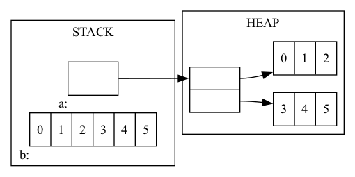
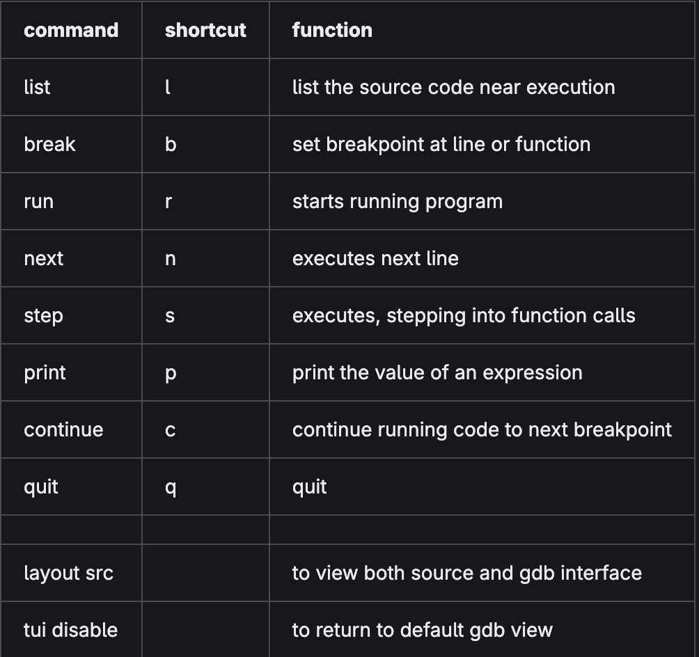

# Introduction

## Lecture 03 (2026-09-15)

Note: Obtain the course contents in [GitHub](https://git.doit.wisc.edu/DAHL/cs354-outlines/-/tree/main?ref_type=heads). 

The lecture.md files are lecture outlines with personal notes. The html files serve as a blank template when looking back through material.

### Lecture Overview

- Multidimensional Arrays
- Structs and Unions
- GDB and Valgrind
- Standard Library Functions

### Multidimensional Arrays (Pointer Arithmetic)

```C
short shorts[4];
int ints[4];
long longs[4];
printf("shorts: %p vs %p\n", &(shorts[0]), &(shorts[1]));
printf("ints: %p vs %p\n", &(ints[0]), &(ints[1]));
printf("longs: %p vs %p\n", &(longs[0]), &(longs[1]));
```

And really the single dimensional array is tracked using the address of the first value inside of it:

```C
int ints[4] = {7,8,9,10};
printf("%p == %p\n", ints, &(ints[0]));
printf("%d == %d\n", *ints, ints[0]);
```

​When an array is used as a pointer in this way, it is said to decay because the compiler loses it’s ability to track the size and dimensionality of that array.

So the indexing notation `ints[x]` is really just performing arithmetic:

```C
int ints[6] = {4,5,6,7,8,9};
printf("%d == %d\n", ints[2], *(ints + 2));
```

Note that a scale factor is being applied for you.  In this case an int is 4 bytes.

```C
short shorts[] = {1,2,3};
int ints[] = {4,5,6,7};
long longs[] = {8,9,10,11,12};
// try printing out the values 2, 7, and 10 from the above arrays,
// WITHOUT using any [] square brackets.
printf("%d", *(shorts + 1))
printf("%d", *(ints + 3))
printf("%ld", *(longs + 2))
```

So arrays and other pointers allow us to pass data by reference to other functions:

```C
void func(int a, int* b, int c[], int *d) {
  a = 11;
  *b = 22;
  c[2] = 33;
  *d = 44;
}
int main(int argc, char** argv) {
  int a = 1, b = 2;
  int c[] = {3,4,5};
  int* d = c+1;
  func(a,&b,c,d);
  printf("%d %d %d %d %d\n",a,b,c[0],c[1],c[2]);
  return 0;
}    
```
```
// Output:
a = 1
b = 22
c = {3,44,33}
d = 44
```

### Multidimensional Arrays (Stack vs Heap)



```C
int **a = malloc(2 * sizeof(int*)); // initialize a as array that makes use of heap memory
a[0] = malloc(3 * sizeof(int));
a[1] = malloc(3 * sizeof(int));
a[0][1] = 1;
*(a + 0) + 2 = 2; // equivalent to: a[0][2] = 2
int b[2][3]; // initialize b as array that makes use of stack memory
b[0][1] = 1;
*(*(b + 1) + 2) = 5;
// and dont't forget to free a when you are done
free(a[1]);
free(a[0]);
free(a) // this happens last so that we don't lose a[0] and a[1]
```

### Multidimensional Array on Stack Practice

Based on your understanding of the organization of stack-based multidimensional arrays in memory.  What do you anticipate the following lines of code to print out? Why?

```C
int c[5][6];
printf("%lu\n", sizeof(c));
// 120
printf("%lu\n", sizeof(c[1]));
// 24
printf("%lu\n", sizeof(c[1][2]));
// 4
printf("%p\n", c); // expect ASLR to randomize this
// e.g., 0x16f83e340
printf("%p\n", &(c[1]));  // so these last two addresses
// e.g., 0x16f83e358
printf("%p\n", &(c[1][2])); // will be relative to c
// e.g., 0x16f83e360
```

And what if we instead use pointer arithmetic here, what outputs do you expect from this?

```C
int c[5][2];
printf("%ld\n", (long)(c+3) - (long)c);
// 24
printf("%ld\n", (long)(*(c+3)+1) - (long)c);
// 28
```

### Passing Multidimensional Arrays as Function Arguments

So, when multidimensional arrays are passed to functions as pointers. What sizes are needed for the compiler to correctly index such arrays?

```C
void printArray(int a[2][4], int rows, int cols) {
  for(int i=0;i<rows;i++) {
    for(int j=0;j<cols;j++)
      printf("%d ", a[i][j]);
    printf("\n");
  }
}

int main(int arc, char** argv) {
  int a[2][4] = {{1,2,3,4},{5,6,7,8}};
  printArray(a, 2, 4);
}
```

### Structs and Unions

#### typedef

C allows you to create name aliases for types using the `typedef` keyword.

```C
typedef int boolean;
boolean x = 1;
x--; // probably better to write: x = !x;
if(x) printf("true\n"); else printf("false\n");
```
#### struct

Arrays in c allow you to organize groups of values of the same type. Structs in c allow you to organize groups of values of different types.

```C
struct person_struct {
  char name[80];
  int  age;
};

struct person_struct x;
strcpy(x.name,"Gary");
x.age = 26;
printf("%s (%d)\n", x.name, x.age);
```

You can define a struct using `typedef`:

```C
typedef struct {
  char name[80];
  int  age;
} person;

person x;
strcpy(x.name,"Gary");
x.age = 26;
printf("%s (%d)\n", x.name, x.age);
```

#### Pointers

You can work with structs using pointers:

```C
typedef struct {
  char name[80];
  int  age;
} person;

person* x = malloc(sizeof(person));
strcpy((*x).name,"Gary"); // parens required...
(*x).age = 26;
printf("%s (%d)\n", (*x).name, (*x).age);

// or use shorthand -> operator to save two characters per reference
printf("%s (%d)\n", x->name, x->age);
```

#### Pointer Arithmetic 

And we can do the similar pointer arithmetic on structs:

```C
typedef struct {
  char name[80];
  int  age;
} person;

person* x = malloc(sizeof(person));
strcpy(x->name,"Gary"); // parens required...
x->age = 26;
printf("%ld\n", (long)&(x->name) - (long)x);
// 0
printf("%ld\n", (long)&(x->age) - (long)x);
// 80
```

How does this change when the struct fields are defined in a different order? Well, we would first reserve space in memory for the first struct field, which will vary by the type, so the memory addresses will be different.

#### Alignment Requirements

```C
typedef struct {
  char  c;
  short s;
  int   i;
} increasing;

typedef struct {
  short s;
  int   i;
  char  c;
} scrambled;

printf("increasing: %lu\n", sizeof(increasing));
// 8
printf("scrambled: %lu\n", sizeof(scrambled));
// 12
```

##### Internal requirement

Each member must be aligned to an offset from the start of the struct that is a multiple of that member’s natural alignment requirement (size in the case of primitives).

##### External requirement

The entire struct must have a size that is a multiple of that struct’s largest member’s natural alignment requirement.

Here's the map of memory for the `scrambled` struct's contents:

|offset in bytes | increasing | scrambled |
| -------------- | --- | ---------------- |
| 0 | c | s |
| 1 | pad | s |
| 2 | s |  pad |
| 3 | s | pad |
| 4 | i | i |
| 5 | i | i |
| 6 | i | i |
| 7 | i | i |
| 8 |   | c |
| 9 |   | pad |
| 10 |   | pad |
| 11 |   | pad |

The size of `scrambled` is 12. It has to satisfy the external requirements so that the size is a multiple of the struct's largest member's natural alignment requirement, which in this case is int (4 bytes). So we add padding until is reaches a size of 12 bytes.

### `union` and `void*`

Unions allow you to define types that can have one of many value types, which can change over time.

```C
int i = 305419896;
void* x = &i;
printf("as int: %x, as char: %x\n", *(int*)x, *(char*)x);

typedef union {
  int i;
  char c;
} intOrChar;
intOrChar y;
y.i = 305419896;
printf("as int: %d, as char: %d\n", y.i, y.c);
```

#### `void* x;`

`void*` is a pointer type that can point to anything and must be cast before dereference.

#### unions

Unions give us a more controlled way to use multiple types (and dereference).

### GDB and Valgrind

#### GDB Debugger

GDB is a debugging tool that can be run through the command line. Common use-case for early CS354: determine where segfault is coming from.

```C
gcc -Wall -std=gnu99 -g code.c
gdb a.out
```



#### Valgrind

Valgrind is another tool that can help check for additional types of memory errors

```C
gcc -Wall -std=gnu99 -g code.c
valgrind --leak-check=full a.out
```

### Standard Library Functions

#### Heap allocation and error checking functions: #include <stdlib.h>

- `void* malloc(size_t size)` // allocate size bytes without initialization
- `void* calloc(size_t num, size_t size)` // allocates num*size bytes initialized to zero
- `void* realloc(void* ptr, size_t size)` // updates size of existing allocation
- `void free(void* ptr)` // frees previously allocated memory for other uses

```C
void* ptr = malloc(sizeof(int)*99999999999999);
if(ptr == NULL)
  printf("malloc error: %s\n", strerror(errno));
else
  free(ptr);
```

### File IO functions: `#include <stdio.h>`

Three standard file descriptors: stdin (0), stdout (1), stderr (2). We can read from and write out to these (and others) using `fgets` and `fprintf`.

```C
fprintf(stdout, "stdout prompt (%d): ", fileno(stdout));
char buffer[80];
fgets(buffer, 80, stdin);
fprintf(stderr, "error(%d): user entered %s", fileno(stderr), buffer);
```

However we can also read from and write to other file descriptors. * in linux every thing is a file

```C
FILE* fout = fopen("tmp.txt","w");
if(fout == NULL) {
  printf("problem opening file for writing: %s\n", strerror(errno));
  return 1;
}
fprintf(fout,"This is some output.\n");
fclose(fout);

FILE* fin = fopen("tmp.txt","r");
if(fin == NULL) {
  printf("problem opening file for reading: %s\n", strerror(errno));
  return 1;
}
char buffer[80];
fgets(buffer,80,fin);
fclose(fin);
printf("read in: %s\n", buffer);
```

### String functions: `#include <string.h>`

```C
char* hello = "Hello";
char buffer[80] = "hello";
int length = strlen(buffer);
printf("length1: %d\n",length);
buffer[0] = 'H';
int cmp = buffer == hello;
printf("cmp1: %d\n",cmp);
cmp = strcmp(buffer,hello);
printf("cmp2: %d\n",cmp);
strcpy(buffer,"hello "); 
strcat(buffer,"goodbye");
length = strlen(buffer);
printf("length2: %d\n",length);
```