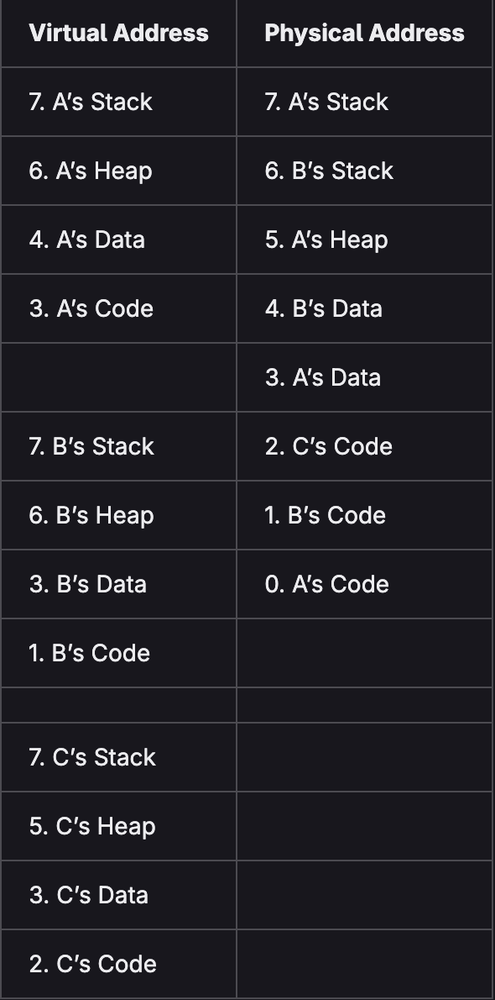
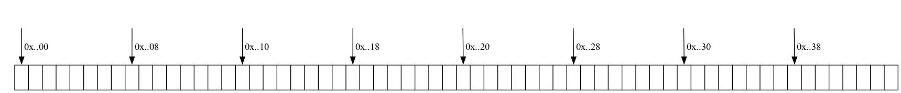

# Introduction

## Lecture 03 (2026-09-15)

Note: Obtain the course contents in [GitHub](https://git.doit.wisc.edu/DAHL/cs354-outlines/-/tree/main?ref_type=heads). 

The lecture.md files are lecture outlines with personal notes. The html files serve as a blank template when looking back through material.

### Lecture Overview

- Wrap-up/Questions from Last Week
- Virtual Memory Layout
- Dynamic Memory Allocation

### Wrap-up/Question from Last Week

#### Valgrind

Valgrind is another tool that can help check for additional types of memory errors

```C
gcc -Wall -std=gnu99 -g code.c
valgrind --leak-check=full a.out
```

### Standard Library Functions

#### Heap allocation and error checking functions: #include <stdlib.h>

- `void* malloc(size_t size)` // allocate size bytes without initialization
- `void* calloc(size_t num, size_t size)` // allocates num*size bytes initialized to zero
- `void* realloc(void* ptr, size_t size)` // updates size of existing allocation
- `void free(void* ptr)` // frees previously allocated memory for other uses

```C
void* ptr = malloc(sizeof(int)*99999999999999);
if(ptr == NULL)
  printf("malloc error: %s\n", strerror(errno));
else
  free(ptr);
```

### File IO functions: `#include <stdio.h>`

Three standard file descriptors: stdin (0), stdout (1), stderr (2). We can read from and write out to these (and others) using `fgets` and `fprintf`.

```C
fprintf(stdout, "stdout prompt (%d): ", fileno(stdout));
char buffer[80];
fgets(buffer, 80, stdin);
fprintf(stderr, "error(%d): user entered %s", fileno(stderr), buffer);
```

However we can also read from and write to other file descriptors. * in linux every thing is a file

```C
FILE* fout = fopen("tmp.txt","w");
if(fout == NULL) {
  printf("problem opening file for writing: %s\n", strerror(errno));
  return 1;
}
fprintf(fout,"This is some output.\n");
fclose(fout);

FILE* fin = fopen("tmp.txt","r");
if(fin == NULL) {
  printf("problem opening file for reading: %s\n", strerror(errno));
  return 1;
}
char buffer[80];
fgets(buffer,80,fin);
fclose(fin);
printf("read in: %s\n", buffer);
```

### String functions: `#include <string.h>`

```C
char* hello = "Hello";
char buffer[80] = "hello";
int length = strlen(buffer);
printf("length1: %d\n",length);
buffer[0] = 'H';
int cmp = buffer == hello;
printf("cmp1: %d\n",cmp);
cmp = strcmp(buffer,hello);
printf("cmp2: %d\n",cmp);
strcpy(buffer,"hello "); 
strcat(buffer,"goodbye");
length = strlen(buffer);
printf("length2: %d\n",length);
```

### Virtual Memory Layout

#### Toy Example

Suppose we have three processes: A, B, and C that each make use of an absurdly small about of memory (8 bytes or pages), on a Computer that has an equally absurdly small amount of memory (8  bytes or pages).



Other data may temporarily be saved to bigger and slower secondary storage (like SSD).

#### Benefits and Drawbacks of Virtual Addressing Abstraction

##### Benefits

1. Provides the illusion of being able to use more memory than is actually available.
2. Protection from processes accessing the memory of other programs.
3. Allows Operating System to oversee “fair” sharing of limited resource.
4. Hides complications the process view of memory.

##### Drawbacks

1. Memory needed to track Page Tables for each process (page table).
2. Time needed to translate virtual into physical address before access.

### Drawback Mitigation Strategies

#### Track Pages of bytes rather than individual bytes.

| Virtual Page Number | Offset | => | Physical Page | NumberOffset |

#### Tradeoffs

- Too small of a page size: Tracking many addresses in memory, which consumes memory.
- Too big of a page size: It may be unnecessary for smaller programs, which will waste memory. It's also going to be slower to copy.

How to check page size on linux machine:

```C
getconf PAGESIZE
```

Operating System utilizes specialized hardware to help this all run faster! That hardware makes use of a TLB Cache (unit 4 will be more about caching). Multi-Level Page Tables help compress memory footprint of page tables.

### Dynamic Memory Allocation

#### Goals

- Implement system for allocating and freeing memory (similar to malloc&free)
- Maximize throughput (speed of new allocation and free operations)
- Maximize memory utilization (minimize waste)

#### Challenges

- Cannot batch requests for later processing, must handle immediately
- Cannot move allocated blocks of memory, users depend on those addresses
- Must respect system’s memory alignment requirements
- Must balance tradeoffs between time and space goals above

### Dynamic Memory Allocation (alignment concerns)

#### Double-word alignment

Payload address returned for each newly allocated heap block should be multiple of 16. Note that word means different amounts in different contexts. On a 64-bit processor, an address fits in 8 bytes (one word), so a double word is 16 bytes.

```C
char* a = malloc(sizeof(char));
short* b = malloc(sizeof(short));
int* c = malloc(sizeof(int));
long* d = malloc(sizeof(long));
printf("%p - %p - %p - %p\n",a,b,c,d);
free(a);free(b);free(c);free(d);
```

#### Alignment Practice

| code | payload size | padding size | total size |
| ---- | ------------ | ------------ | ---------- |
| malloc(2*sizeof(short)) | 4 | 12 | 16 |
| malloc(3*sizeof(int)) | 12 | 4 | 16 |
| malloc(100*sizeof(char)) | 100 | 12 | 112 |
| malloc(3*sizeof(long)) | 24 | 12 | 32 |

### Dynamic Memory Allocation (block management)

#### Things to track per Block

- size of block
- location of block
- block status (whether it is free vs allocated)

### Header Data
When blocks are consecutive, f(size) => location. So storing each blocks size allows us to step through blocks on the heap. We’ll store this block size in the header (first four bytes of each block, as int). In order for the payload to be double-word aligned, headers precede such boundaries.

### Allocation Information

Sizes are all double-word aligned.

What does this tell us about the bits making up the int size in each block header.

### Re-purposing bits

Use left-most to store allocated (1) vs free (0) block status,

### Bit Checking and Masking

```C
int headers[] = {33, 49, 64, 80};
if( headers[0] & 1 ) printf("[0]: is allocated\n");
if( headers[1] % 2 ) printf("[1]: is allocated\n");
headers[2] = headers[2] | 1; // change to allocated
headers[3] = headers[3] + 1; // change to allocated
if( headers[2] & 1 ) printf("[2]: is now allocated\n");
if( headers[3] % 2 ) printf("[3]: is now allocated\n");
```

### Dynamic Memory Allocation (placement)

#### Sample First Fit Placement Policy

Fill in the following diagram, to show heap contents corresponding to the following code. Place each new heap block as far to the left as possible.  Think about doing this algorithmicly.

```C
int* a = my_alloc(2*sizeof(int));
int* b = my_alloc(5*sizeof(int));
char* c = my_alloc(3*sizeof(char));
```



